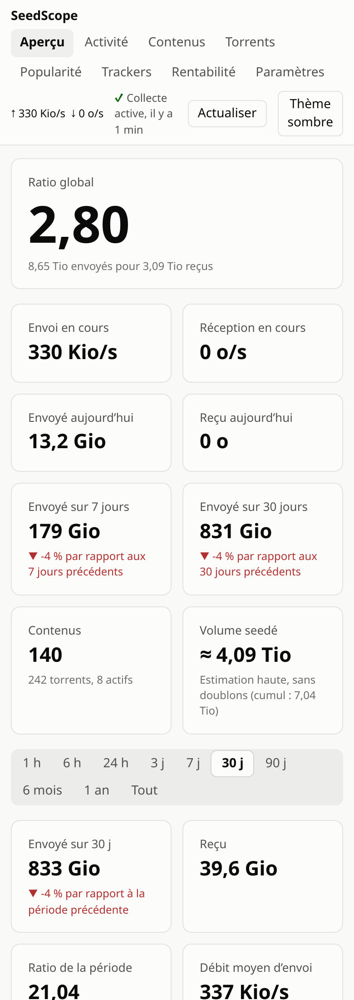
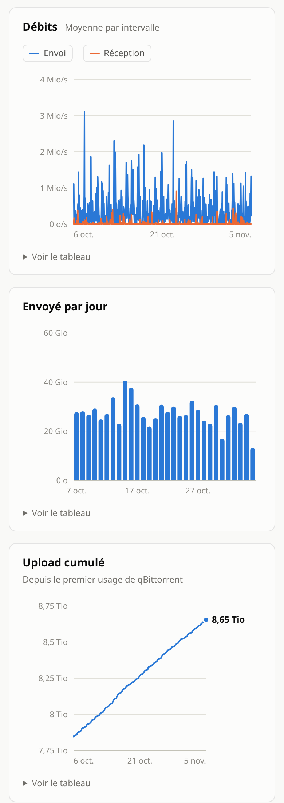
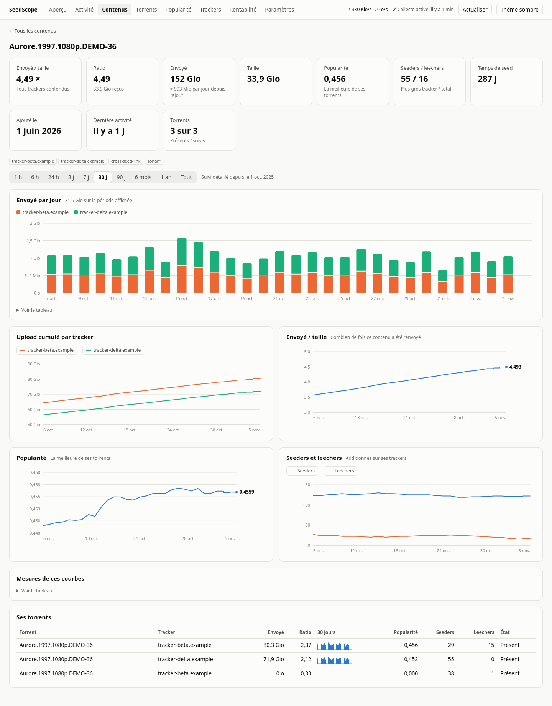
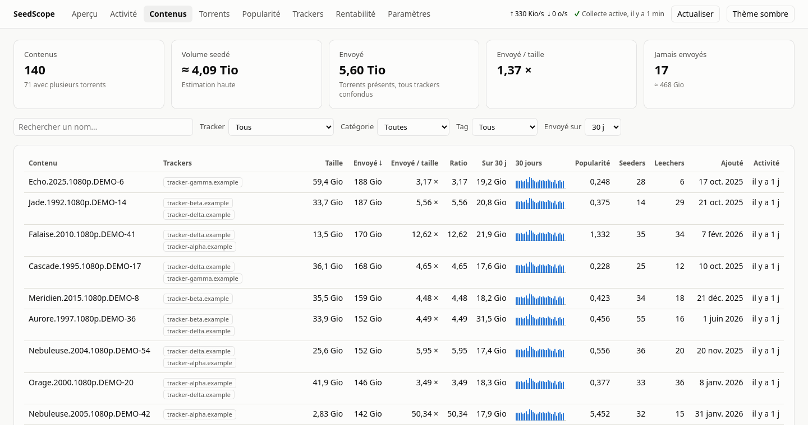
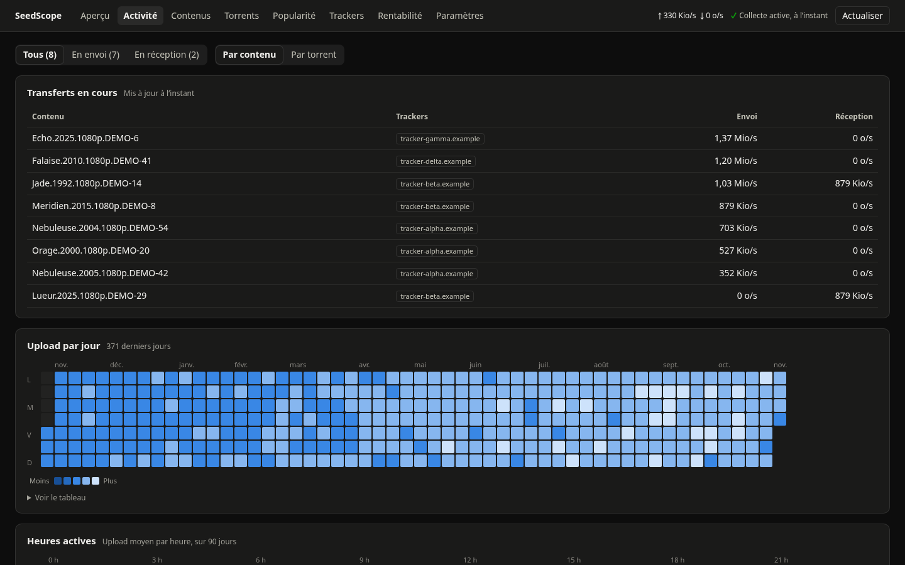
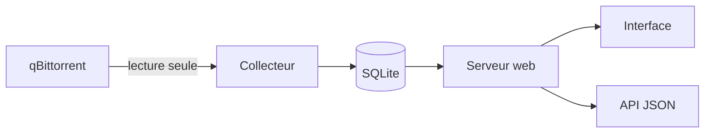

# SeedScope

**Les statistiques de qBittorrent sur la durée : ratio, courbes, contenus, trackers et rentabilité du stockage.**

SeedScope remplace une pile Prometheus + Grafana par un seul conteneur, pensé pour un NAS : environ 20 Mio de RAM,
aucune dépendance Python et une interface prête à l'emploi. Il suit chaque cross-seed séparément, puis les additionne
par contenu. Il se contente de lire qBittorrent et n'y modifie jamais rien.


<p align="center">
  
  &nbsp;&nbsp;
  
</p>

<p align="center"><em>Toutes les captures utilisent les données fictives du mode démo.</em></p>

## Sommaire

- [Fonctionnalités](#fonctionnalités)
- [Captures](#captures)
- [Installation](#installation)
- [Configuration](#configuration)
- [Sauvegarde et mise à jour](#sauvegarde-et-mise-à-jour)
- [Intégrations](#intégrations)
- [Lire les chiffres](#lire-les-chiffres)
- [Sécurité](#sécurité)
- [Fonctionnement](#fonctionnement)
- [Développement](#développement)

## Fonctionnalités

| Page | Ce qu'on y trouve |
|---|---|
| **Aperçu** | Ratio global, envoi et réception en cours, totaux, débit moyen et pic de la période, courbes de débit et de ratio, upload cumulé, contenus qui ont le plus envoyé |
| **Activité** | Transferts en cours, filtrés par sens, avec progression et temps restant ; calendrier annuel de l'upload ; heures les plus actives |
| **Contenus** | Stats tous trackers confondus, recherche, filtres, tri et mini-courbe sur 30 jours ; une page par contenu avec ses courbes par tracker |
| **Torrents** | Même tableau par torrent, supprimés inclus ; une page par torrent avec upload, ratio, popularité, seeders et leechers |
| **Popularité** | Les plus populaires, les plus demandés et les moins seedés, par contenu ou par torrent ; moyenne par tracker |
| **Trackers** | Upload dans le temps, part de chacun, volume et ratio, par tracker ou par catégorie |
| **Rentabilité** | Upload rapporté à l'espace occupé, et poids morts selon un seuil d'inactivité. SeedScope suggère, mais ne supprime rien |
| **Paramètres** | Mode et palette de couleurs, durée affichée à l'ouverture, fréquences de collecte et conservation des données |

Sur toutes les pages :

- **Dix durées** : 1 h, 6 h, 24 h, 3 j, 7 j, 30 j, 90 j, 6 mois, 1 an ou tout l'historique.
- **Courbes à la carte** : un clic sur la légende masque l'envoi, la réception ou un tracker, et l'échelle s'adapte.
- **Bouton Actualiser** : lance tout de suite une collecte complète.
- **Quatre palettes de couleurs** en mode clair, sombre ou système, vérifiées pour le contraste et le daltonisme.
- **Interface adaptée au mobile**, navigation au clavier, et un tableau pour chaque graphique.

## Captures

**Page d'un contenu** : upload par tracker, envoyé / taille, popularité, seeders et leechers.



**Contenus** : tous tes contenus, avec leurs trackers et une mini-courbe sur 30 jours.



**Activité, en thème sombre** : transferts en cours et calendrier de l'upload.



## Installation

Il faut Docker avec Compose, et l'interface web de qBittorrent activée.

```sh
git clone https://github.com/GraberThomas/seedscope.git
cd seedscope
cp .env.example .env
chmod 600 .env
# renseigner .env, puis :
docker compose up -d --build
```

L'interface répond sur `http://<ip-du-serveur>:3310/`. Les premières données arrivent en moins d'une minute.

## Configuration

### Fichier `.env`

| Variable | Rôle | Défaut |
|---|---|---|
| `QBT_URL` | Adresse de l'interface web de qBittorrent, vue depuis le conteneur | requis |
| `QBT_USERNAME`, `QBT_PASSWORD` | Identifiants de qBittorrent | requis |
| `SEEDSCOPE_LAN_IP` | Adresse locale sur laquelle publier l'interface | requis |
| `SEEDSCOPE_PORT` | Port publié | `3310` |
| `SEEDSCOPE_TRACKER_ALIASES` | Regroupe plusieurs hôtes d'un tracker : `hote1=Nom,hote2=Nom` | vide |
| `TZ` | Fuseau utilisé pour découper les jours | `Europe/Paris` |

Les passkeys ne servent à rien ici : donnez seulement les noms d'hôtes aux alias.

### Fréquences de collecte

Elles se règlent dans la page **Paramètres** et s'appliquent immédiatement.

| Données | Défaut | Choix |
|---|---|---|
| Stats globales et transferts en cours | 1 min | 30 s, 1, 2 ou 5 min |
| Détail par torrent | 5 min | 1, 5, 10, 15, 30 min ou 1 h |

### Conservation des données

**Par défaut, SeedScope ne supprime rien.** Chaque type de données fines peut être limité dans la page **Paramètres**, de
30 jours à 5 ans. Une limite plus courte ne s'applique qu'après une confirmation qui annonce le nombre de mesures à
supprimer. Ensuite, ce qui dépasse la durée choisie est supprimé au fil de l'eau, et cette suppression est définitive.

Les agrégats par heure et par jour, ainsi qu'une mesure par jour et par torrent, sont toujours conservés.

### Options avancées

Ces variables ne sont pas transmises par `compose.yaml` : ajoutez-les à sa section `environment` pour les modifier.

| Variable | Rôle | Défaut |
|---|---|---|
| `SEEDSCOPE_GLOBAL_INTERVAL` | Fréquence globale en secondes, tant que la page Paramètres n'a rien enregistré | `60` |
| `SEEDSCOPE_TORRENT_INTERVAL` | Fréquence par torrent en secondes, tant que la page Paramètres n'a rien enregistré | `300` |

## Sauvegarde et mise à jour

> [!IMPORTANT]
> L'historique n'existe que dans la base SQLite, et SeedScope ne la sauvegarde pas lui-même. Pensez à en garder une copie.

**Sauvegarder**, sans arrêter le service :

```sh
docker exec seedscope python -c "import sqlite3; sqlite3.connect('/data/seedscope.db').execute(\"VACUUM INTO '/data/backup.db'\")"
docker cp seedscope:/data/backup.db ./seedscope-backup.db
docker exec seedscope rm /data/backup.db
```

**Restaurer** :

```sh
docker compose stop seedscope
docker run --rm -v seedscope_seedscope-data:/data -v "$PWD/seedscope-backup.db:/backup.db:ro" alpine \
  sh -c 'rm -f /data/seedscope.db-wal /data/seedscope.db-shm; cp /backup.db /data/seedscope.db; chown -R 10001:10001 /data'
docker compose start seedscope
```

**Mettre à jour** : la base est migrée automatiquement au démarrage.

```sh
git pull
docker compose up -d --build
```

## Intégrations

### Reprendre l'historique de Prometheus

Si vous utilisez [qbittorrent-exporter](https://github.com/martabal/qbittorrent-exporter), l'historique global peut être
importé une seule fois, avant de supprimer Prometheus. Les séries par torrent sont ignorées, car l'exporter les
identifie par nom et confond donc les cross-seeds.

```sh
docker run --rm --network <reseau-de-prometheus> -v seedscope_seedscope-data:/data \
  -e TZ=Europe/Paris seedscope:local \
  python -m seedscope.backfill --prometheus http://prometheus:9090
```

### Tuile Homepage

```yaml
- SeedScope:
    href: http://<serveur>:3310/
    widget:
      type: customapi
      url: http://<serveur>:3310/api/summary
      mappings:
        - { field: ratio, label: Ratio, format: float }
        - { field: up_today, label: Aujourd'hui, format: bytes }
        - { field: up_7d, label: 7 jours, format: bytes }
```

### API JSON

| Route | Contenu |
|---|---|
| `GET /api/summary` | Ratio, débits et totaux du moment |
| `GET /api/timeseries?range=7d` | Courbes globales, volumes et stats de la période |
| `GET /api/contents`, `/api/contents/summary`, `/api/contents/top` | Contenus, résumé et classement |
| `GET /api/content?key=…&range=30d` | Détail d'un contenu |
| `GET /api/torrents`, `/api/torrent/<hash>?range=30d` | Torrents et détail d'un torrent |
| `GET /api/live` | Transferts en cours |
| `GET /api/breakdown?by=tracker&range=30d` | Répartition par tracker ou par catégorie |
| `GET /api/popularity`, `/api/calendar`, `/api/heatmap`, `/api/filters` | Vues spécialisées |
| `GET` ou `POST /api/settings` | Lire les réglages, modifier les fréquences de collecte |
| `POST /api/settings/retention` | Modifier la conservation : répond `409` tant que `confirm_delete` n'est pas à `true` si une durée raccourcit |
| `POST /api/collect` | Demander une collecte immédiate |
| `GET /healthz` | État du service |

## Lire les chiffres

- **Historique** : les courbes partent du début de la collecte. Les totaux antérieurs de qBittorrent servent de point
  de départ, sans créer de faux pic.
- **Ratio** : c'est celui de qBittorrent. Il peut différer de celui affiché par les trackers.
- **Popularité** : c'est la valeur de qBittorrent, soit le ratio divisé par le nombre de mois actifs. Elle mesure ce qui a
  tourné pour vous. Les leechers annoncés reflètent mieux la demande actuelle.
- **Contenus** : les torrents d'au moins 50 Mio sont regroupés par taille exacte en octets, ce qui peut rarement réunir
  deux contenus différents. Un épisode et le pack de saison qui le contient restent deux contenus, donc le volume seedé
  est une estimation haute.
- **Inactivité** : basée sur la dernière activité vue par qBittorrent. Un contenu n'est inactif que si tous ses torrents
  le sont et qu'il est lui-même plus ancien que le seuil.
- **Débits en cours** : ils datent de la dernière collecte, et non de l'instant présent.
- **Pic et courbes** : le pic vient des mesures les plus fines, alors que les courbes longues affichent des moyennes.
  Il peut donc dépasser le haut de la courbe.
- **Coupures** : l'upload transféré pendant un arrêt de SeedScope est compté à la reprise.
- **Upload d'une période** : c'est la somme de ce que chaque torrent a envoyé à chaque collecte, soit toutes les 5 minutes
  par défaut. Le compteur global de qBittorrent inclut aussi le trafic réseau, qui grimpe pendant un gros téléchargement :
  il n'alimente que le ratio global et l'upload cumulé, pour rester identiques à qBittorrent.
- **Torrents supprimés** : ce qu'ils ont envoyé reste compté. Seul l'upload transféré depuis la dernière collecte, juste
  avant la suppression, est perdu.

## Sécurité

> [!WARNING]
> L'interface n'a **pas d'authentification**. Toute personne qui y accède voit les stats et les noms de torrents, peut
> changer les réglages, **y compris confirmer la suppression d'un historique**, et lancer une collecte. Publiez-la
> uniquement sur un réseau de confiance, jamais sur Internet.

- **qBittorrent** : le client n'envoie aucune autre requête d'écriture que la connexion.
- **Passkeys** : les URL d'annonce en contiennent une, donc seul le nom d'hôte du tracker est conservé.
- **Écritures** : seules des valeurs prédéfinies sont acceptées, les requêtes venant d'un autre site sont refusées, et une
  collecte manuelle au plus est possible toutes les 10 secondes.
- **Conteneur** : système de fichiers en lecture seule, utilisateur non root et aucune capacité Linux.
- **Noms de torrents** : ils ne sont jamais interprétés comme du HTML (`textContent` et Content-Security-Policy stricte).
- **Identifiants refusés** : SeedScope attend 30 minutes avant de réessayer, pour ne pas déclencher le bannissement d'IP
  de qBittorrent.

## Fonctionnement



| Fichier | Rôle |
|---|---|
| `seedscope/qbit.py` | Client de l'API qBittorrent, en lecture seule |
| `seedscope/collector.py` | Boucle de collecte, calcul des écarts, agrégats et purge |
| `seedscope/db.py` | Schéma SQLite et migrations |
| `seedscope/settings.py` | Réglages modifiables depuis l'interface |
| `seedscope/queries.py` | Requêtes de l'API |
| `seedscope/web.py` | Serveur HTTP, statique et JSON |
| `seedscope/static/` | Interface, sans framework ni dépendance |
| `seedscope/backfill.py` | Import unique depuis Prometheus |

| Table | Contenu | Conservation |
|---|---|---|
| `global_minute` | Débits et compteurs globaux | Illimitée par défaut, réglable |
| `global_hourly` | Agrégats globaux par heure | Toujours gardée |
| `torrent_hourly` | Upload et download par torrent et par heure | Illimitée par défaut, réglable |
| `torrent_daily` | Upload et download par torrent et par jour | Toujours gardée |
| `torrent_samples` | Upload, ratio, popularité et pairs par torrent | Mesures fines et horaires illimitées par défaut, réglables ; une par jour toujours gardée |
| `torrents` | Dernier état de chaque torrent, supprimés inclus | Toujours gardée |

Une mesure par torrent n'est enregistrée que si une valeur a changé, et au moins une fois par heure.

## Développement

Python 3.13 et sa bibliothèque standard suffisent.

```sh
python -m unittest discover -s tests -t .   # tests
python scripts/demo.py                      # interface sur données fictives, http://127.0.0.1:8080
```

La CI lance les tests, vérifie la syntaxe JavaScript et construit l'image Docker à chaque push sur `main` et à chaque
pull request.
