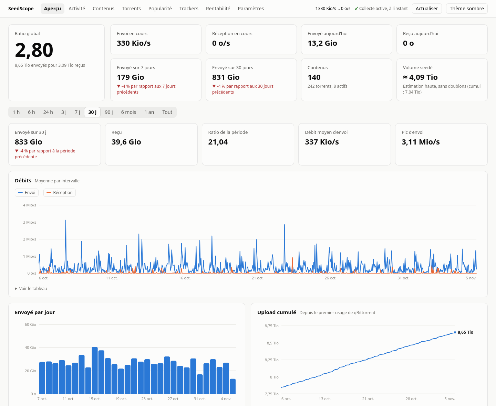

# SeedScope

Statistiques de qBittorrent sur la durée : ratio, courbes, trackers et rentabilité du stockage.
Une alternative légère à une pile Prometheus + Grafana, conçue pour un NAS : un seul conteneur,
aucune dépendance Python, environ 20 Mio de RAM.



## Fonctionnalités

- **Aperçu** : ratio global, débits, volume envoyé, upload cumulé et évolution du ratio, avec les totaux,
  le débit moyen et le pic de la période. Dix durées : 1 h, 6 h, 24 h, 3 j, 7 j, 30 j, 90 j, 6 mois, 1 an, tout.
- **Activité** : torrents en cours de transfert, calendrier annuel de l'upload, heures les plus actives.
- **Torrents** : tableau triable et filtrable avec mini-courbe sur 30 jours, torrents supprimés inclus.
- **Page par torrent** : courbes d'upload, de ratio, de popularité, de seeders et de leechers.
- **Popularité** : torrents les plus populaires, les plus demandés et les moins seedés, moyenne par tracker.
- **Trackers et catégories** : upload dans le temps, part de chacun, volume et ratio.
- **Rentabilité** : upload rapporté à l'espace occupé, et poids morts à partir d'un seuil d'inactivité.
- **Paramètres** : fréquences de collecte, modifiables sans redémarrage.

Les cross-seeds sont suivis séparément, par hash. Les vues de rentabilité les regroupent par contenu,
car supprimer un seul d'entre eux ne libère aucun espace.

SeedScope **lit** qBittorrent et ne modifie jamais rien : son client n'envoie aucune autre requête
d'écriture que la connexion.

## Installation

```sh
cp .env.example .env
chmod 600 .env
# renseigner .env
docker compose up -d --build
```

L'interface répond sur `http://<ip-du-serveur>:3310/`.

| Variable | Rôle | Défaut |
|---|---|---|
| `QBT_URL` | Adresse de l'interface web de qBittorrent, vue depuis le conteneur | requis |
| `QBT_USERNAME`, `QBT_PASSWORD` | Identifiants de qBittorrent | requis |
| `SEEDSCOPE_LAN_IP` | Adresse locale sur laquelle publier l'interface | requis |
| `SEEDSCOPE_PORT` | Port publié | `3310` |
| `SEEDSCOPE_TRACKER_ALIASES` | Regroupe des hôtes : `hote1=Nom,hote2=Nom` | vide |
| `SEEDSCOPE_GLOBAL_INTERVAL` | Collecte des compteurs globaux, en secondes, tant que la page Paramètres n'a rien enregistré | `60` |
| `SEEDSCOPE_TORRENT_INTERVAL` | Collecte par torrent, en secondes, tant que la page Paramètres n'a rien enregistré | `300` |
| `SEEDSCOPE_MINUTE_RETENTION_DAYS` | Conservation des mesures globales à la minute | `90` |
| `SEEDSCOPE_HOURLY_RETENTION_DAYS` | Conservation de l'upload horaire par torrent | `365` |
| `SEEDSCOPE_SAMPLE_FINE_RETENTION_DAYS` | Courbes par torrent, mesures toutes les 5 min | `30` |
| `SEEDSCOPE_SAMPLE_HOURLY_RETENTION_DAYS` | Courbes par torrent, mesures horaires | `180` |
| `TZ` | Fuseau utilisé pour découper les jours | `Europe/Paris` |

Les variables d'intervalle et de conservation ne sont pas transmises par `compose.yaml` : ajoutez-les à sa
section `environment` pour les modifier.

### Reprendre l'historique de Prometheus

Avec [qbittorrent-exporter](https://github.com/martabal/qbittorrent-exporter), l'historique global peut être
importé une seule fois. Les séries par torrent sont ignorées, car l'exporter les identifie par nom et confond
donc les cross-seeds.

```sh
docker run --rm --network <reseau-de-prometheus> -v seedscope_seedscope-data:/data \
  -e TZ=Europe/Paris seedscope:local \
  python -m seedscope.backfill --prometheus http://prometheus:9090
```

### Tuile Homepage

```yaml
- SeedScope:
    href: http://<serveur>:3310/
    widget:
      type: customapi
      url: http://<serveur>:3310/api/summary
      mappings:
        - { field: ratio, label: Ratio, format: float }
        - { field: up_today, label: Aujourd'hui, format: bytes }
        - { field: up_7d, label: 7 jours, format: bytes }
```

## Lire les chiffres

- **Historique** : les courbes partent du début de la collecte. Avant cela, seuls les totaux de qBittorrent
  existent : ils servent de point de départ sans créer de faux pic.
- **Popularité** : c'est la valeur de qBittorrent, soit le ratio divisé par le nombre de mois actifs. Elle mesure ce
  qui a tourné pour vous, pas la demande actuelle, que les leechers annoncés reflètent mieux.
- **Courbes par torrent** : elles partent de la version 0.2. Une mesure est prise quand quelque chose change, et au
  moins une fois par heure. Les vues longues se contentent des mesures horaires, puis quotidiennes.
- **Ratio** : c'est celui de qBittorrent. Il peut différer de celui affiché par les trackers.
- **Volume seedé** : estimation haute. Les contenus sont regroupés par taille exacte, ce qui ne détecte pas un
  épisode partageant ses fichiers avec un pack de saison.
- **Inactivité** : basée sur la dernière activité vue par qBittorrent. Un contenu n'est considéré inactif que si
  tous ses torrents le sont et qu'il est lui-même plus ancien que le seuil.
- **Coupures** : l'upload transféré pendant un arrêt de SeedScope est compté à la reprise, sur l'heure en cours.

## Sécurité

- L'interface n'a **pas d'authentification** : toute personne qui y accède voit les stats et peut changer les
  fréquences de collecte. Publiez-la uniquement sur un réseau de confiance, jamais sur Internet.
- Seules des valeurs prédéfinies sont acceptées, et les requêtes venant d'un autre site sont refusées.
- Les URL d'annonce contiennent votre passkey : seul le nom d'hôte du tracker est conservé.
- Le conteneur est en lecture seule, sans capacité Linux, et les noms de torrents ne sont jamais interprétés comme
  du HTML (`textContent` et Content-Security-Policy stricte).
- Après un refus d'identifiants, SeedScope attend 30 minutes avant de réessayer, pour ne pas déclencher le
  bannissement d'IP de qBittorrent.

## Architecture

| Fichier | Rôle |
|---|---|
| `seedscope/qbit.py` | Client de l'API qBittorrent, en lecture seule |
| `seedscope/collector.py` | Boucle de collecte, calcul des écarts, agrégats et purge |
| `seedscope/db.py` | Schéma SQLite et migrations |
| `seedscope/queries.py` | Requêtes de l'API |
| `seedscope/web.py` | Serveur HTTP, statique et JSON |
| `seedscope/static/` | Interface, sans framework ni dépendance |
| `seedscope/backfill.py` | Import unique depuis Prometheus |

| Table | Contenu | Conservation |
|---|---|---|
| `global_minute` | Débits et compteurs globaux | 90 jours |
| `global_hourly` | Agrégats globaux par heure | Illimitée |
| `torrent_hourly` | Upload et download par torrent et par heure | 1 an |
| `torrent_daily` | Upload et download par torrent et par jour | Illimitée |
| `torrent_samples` | Upload, ratio, popularité et pairs par torrent | 30 jours à 5 min, 6 mois à l'heure, puis un point par jour |
| `torrents` | Dernier état de chaque torrent, supprimés inclus | Illimitée |

## Développement

```sh
python -m unittest discover -s tests -t .   # tests
python scripts/demo.py                      # interface sur données fictives, http://127.0.0.1:8080
```

Python 3.13 et sa bibliothèque standard suffisent.
